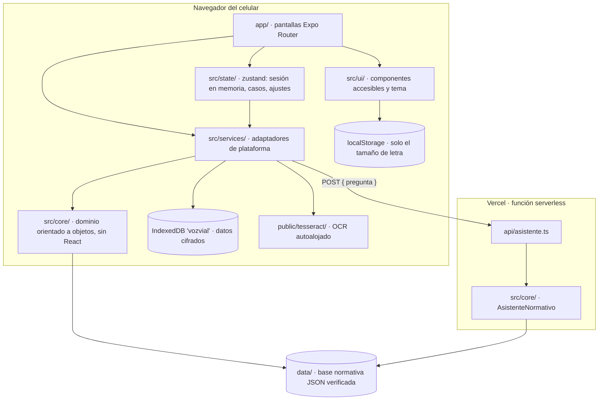
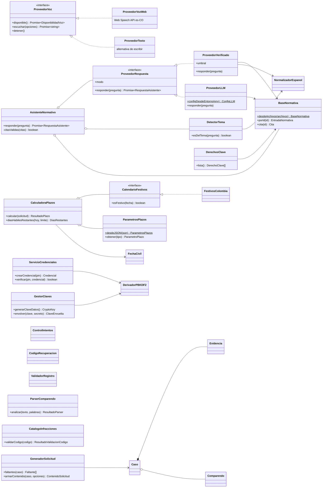
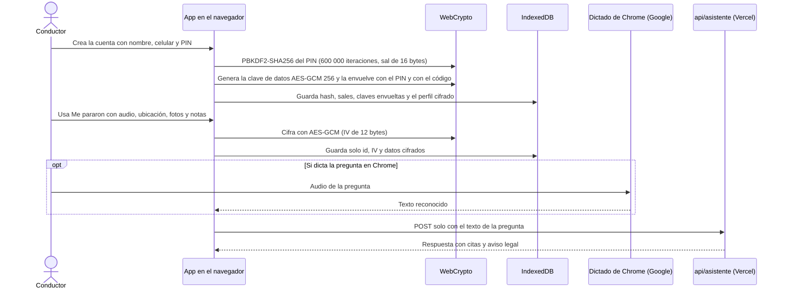

# VozVial · manual técnico del prototipo

VozVial es una app móvil con asistente de voz para que conductores en Colombia, en especial adultos mayores, entiendan sus derechos frente a un comparendo de tránsito. La app también sirve para registrar lo que pasa durante el procedimiento, calcular los plazos legales y, en la entrega final, generar la solicitud de audiencia.

- Proyecto del curso "Proyecto de software". Este repositorio contiene el **prototipo funcional (actividad 4)**, que será la base de la entrega final (actividad 6).
- Equipo: Juan David González Varilla (líder) y un colaborador.
- Objetivo evaluado: la **web en vista móvil**, hecha con Expo (React Native con salida web) y pensada para desplegarse en Vercel.
- Aviso que se ve en la app: "VozVial informa y organiza. No reemplaza a un abogado."

## Contenido

1. [Estado del prototipo](#1-estado-del-prototipo)
2. [Arquitectura](#2-arquitectura)
3. [Requisitos e instalación](#3-requisitos-e-instalación)
4. [Variables de entorno](#4-variables-de-entorno)
5. [Comandos y pruebas](#5-comandos-y-pruebas)
6. [Despliegue](#6-despliegue)
7. [Flujo de datos y privacidad](#7-flujo-de-datos-y-privacidad)
8. [Base normativa](#8-base-normativa)
9. [Limitaciones](#9-limitaciones)
10. [Documentos del proyecto](#10-documentos-del-proyecto)

## 1. Estado del prototipo

La evaluación se hace con las historias y criterios de `docs/historias-usuario.md`. Cada criterio tiene una prueba e2e con su id en el nombre y una captura en `evidencias/`. La matriz `docs/evaluacion/matriz-criterios.md` se genera sola al correr Playwright.

| Módulo | Historias | Estado |
|---|---|---|
| 1 · Cuenta y acceso | HU-01, HU-02, HU-03 | Completo: 12 de 12 criterios cumplen |
| 2 · Accesibilidad | HU-04 | Parcial. CA-04.3 (axe) cumple. CA-04.1 (tamaño de letra) y CA-04.2 (Escuchar) están en la app pero no tienen prueba e2e, así que la matriz los muestra "Sin prueba" |
| 3 · Asistente por voz | HU-05, HU-06 | Completo: 8 de 8 criterios cumplen |
| 4 · Me pararon y evidencias | HU-07, HU-08 | Completo: 7 de 7 criterios cumplen |
| 5 · Comparendo y plazos | HU-09 a HU-12 | Completo: 11 cumplen y 1 cumple parcialmente (CA-10.2, ver abajo) |
| 6 · Documentos | HU-13 | Pospuesto para la entrega final. La pantalla todavía muestra datos de ejemplo marcados "Ejemplo" |
| 7 · Historial y privacidad | HU-14 | Pospuesto para la entrega final. Hay lista de casos, pero sin orden por urgencia probado, sin exportar y sin borrar con prueba |
| RNF-01 · Privacidad | — | Cumple: la petición al asistente solo lleva `{ pregunta }` |

Resumen de la matriz al 8 de noviembre de 2026: **50 criterios: 40 Cumple, 1 Cumple parcialmente, 0 No cumple, 9 Sin prueba**. Los 9 sin prueba son CA-04.1, CA-04.2, los 3 de HU-13 y los 4 de HU-14.

**CA-10.2 cumple solo en parte.** El valor en pesos de 2026 no está verificado: la Resolución de MinHacienda con el valor de la UVB no se pudo descargar. Por eso la app muestra la sanción en su unidad legal (por ejemplo, 15 SMDLV) con su fuente y fecha de consulta, y remite a SIMIT. No muestra "Valor de referencia para AAAA". El detalle está en `docs/pendientes-verificacion.md`.

RNF-02 (tiempo de respuesta) y RNF-03 (precisión del asistente) se miden con `npm run eval:asistente`. El resultado está en `docs/evaluacion/asistente.md`.

## 2. Arquitectura

### 2.1 Capas



- **`app/`** solo orquesta: lee el estado, llama a los servicios y muestra el resultado.
  - Rutas públicas en `app/(publico)/`: bienvenida, registro, código de recuperación, entrar, recuperar, privacidad y acerca.
  - Rutas con sesión en `app/(app)/`: inicio, asistente, me-pararon, casos, comparendo, solicitud y ajustes.
- **`src/core/`** guarda la lógica de dominio en clases TypeScript puras. Una prueba unitaria verifica que no importa React ni Expo. La comparten la app y el servidor.
- **`src/services/`** adapta el navegador al dominio:
  - `AlmacenCifrado` (IndexedDB), `ServicioCuenta`, `RepositorioCasos`;
  - `ProveedorVozWeb` y `ProveedorTexto`, `ServicioLecturaVoz` (`expo-speech`);
  - `GrabadorAudio` (MediaRecorder), `ServicioFotos`, `ServicioUbicacion`;
  - `ServicioOCR` (tesseract.js), `ServicioPlazos`, `ClienteAsistente`, `ServicioConectividad`, `RegistroMePararon`.
- **`api/asistente.ts`** es el endpoint `POST /api/asistente`. Usa `crearAsistente()` de `src/core/cargarDatos.ts`, el mismo código que corre en las pruebas.
- **`data/`** guarda la base normativa (`normativa/*.json`), el catálogo `infracciones.json`, `preguntas-verificadas.json`, `banco-evaluacion.json` y las descargas crudas en `fuentes/`.

### 2.2 Clases principales de `src/core/`



- `ProveedorVoz` es una interfaz de `src/core/ProveedorVoz.ts`. Sus dos implementaciones viven en `src/services/`, porque dependen del navegador.
- `AsistenteNormativo` aplica dos garantías con cualquier proveedor:
  - toda respuesta lleva el aviso legal;
  - una respuesta sin cita, o con una cita que no coincide con la base (mismo id, mismo texto literal y misma URL), se convierte en abstención.
- `CalculadoraPlazos` no tiene los días escritos en el código: los lee de `data/normativa/parametros.json` a través de `ParametrosPlazos`, que rechaza los parámetros con `verificado: false`.

### 2.3 Asistente: dos modos

- **Modo verificado (predeterminado, el evaluado).** `ProveedorVerificado` busca con MiniSearch, después de normalizar el español, entre las preguntas verificadas y sus variantes.
  - Si el puntaje supera el umbral, devuelve la `respuesta_sencilla` ya revisada, con sus citas.
  - Si no lo supera, se abstiene.
  - Nunca genera texto.
- **Modo LLM (opcional, apagado).** `ProveedorLLM` solo se crea si existen `LLM_BASE_URL` y `LLM_MODELO`.
  - Manda fragmentos de la base a un endpoint compatible con OpenAI (`/v1/chat/completions`, `temperature: 0`, `response_format: json_object`) y exige `{"respuesta", "citas"}`.
  - Si una cita no está entre los fragmentos recuperados, si el JSON no sirve o si se agota el tiempo, se abstiene.
  - No se evaluó en el prototipo.

## 3. Requisitos e instalación

Requisitos:
- Node.js 20 o superior y npm;
- git;
- Google Chrome o Edge para el dictado por voz (Web Speech API). En Firefox no hay dictado y la app ofrece escribir;
- para las pruebas e2e, Chromium de Playwright (`npx playwright install chromium`, una sola vez) y la herramienta `flock` (viene en Linux; la usa `scripts/build-e2e.sh`).

Instalación:

```bash
git clone <url-del-repositorio> vozvial
cd vozvial
npm ci
```

La app necesita un **contexto seguro** (HTTPS o `localhost`) porque usa WebCrypto (`crypto.subtle`). Si se abre por la IP de la red local (`http://192.168…`), no se puede crear la cuenta. Para probar en un celular, usa el enlace HTTPS publicado: https://vozvial-production.up.railway.app

## 4. Variables de entorno

Ninguna es obligatoria. Estas son las que el código lee de verdad:

| Variable | Dónde se lee | Para qué | Valor por defecto |
|---|---|---|---|
| `EXPO_PUBLIC_API_URL` | `src/services/ClienteAsistente.ts` (en el build de la app) | Origen del API del asistente, sin barra final. Sirve en desarrollo para apuntar a `http://localhost:3001`. En Vercel se deja vacía: la CSP solo permite conectarse al mismo origen | vacío (mismo origen) |
| `EXPO_PUBLIC_BLOQUEO_MS` | `src/state/configuracion.ts` | Duración del bloqueo tras 5 PIN incorrectos (CA-02.3) | 300000 (5 min) |
| `EXPO_PUBLIC_INACTIVIDAD_MS` | `src/state/configuracion.ts` | Tiempo sin actividad antes de cerrar la sesión (CA-02.4) | 600000 (10 min) |
| `EXPO_PUBLIC_PBKDF2_ITERACIONES` | `src/state/configuracion.ts` | Iteraciones de PBKDF2 para el PIN y las claves | 600000 |
| `LLM_BASE_URL` | `src/core/ProveedorLLM.ts` (en el servidor) | Endpoint compatible con OpenAI (por ejemplo vLLM en RunPod). Si falta, el modo LLM queda apagado | sin valor |
| `LLM_MODELO` | `src/core/ProveedorLLM.ts` | Nombre del modelo que sirve el endpoint. También es obligatoria para activar el modo LLM | sin valor |
| `LLM_API_KEY` | `src/core/ProveedorLLM.ts` | Se manda como `Authorization: Bearer …` si existe | sin valor |
| `LLM_TIMEOUT_MS` | `src/core/ProveedorLLM.ts` | Tiempo máximo de espera del LLM | 15000 |
| `PORT` | `scripts/servidor-api.ts` y `scripts/servidor-e2e.ts` | Puerto de los servidores locales | 3001 y 4173 |
| `E2E_PUERTO`, `E2E_DIST` | `playwright.config.ts` | Puerto y carpeta de build de una suite e2e aislada | 4173 y `dist` |
| `DISENO_RAPIDO` | `e2e/diseno-rapido.spec.ts` | Si vale `1`, corre la suite que regenera las capturas de los wireframes | sin valor (se omite) |

- Las `EXPO_PUBLIC_*` las reemplaza Expo **al compilar**, así que hay que definirlas antes de `expo export` o `expo start`.
- Los tiempos cortos (3 s de bloqueo, 5 s de inactividad, 1000 iteraciones) se usan **solo** en el build de e2e (`scripts/build-e2e.sh` y `npm run build:web:e2e`). La app publicada usa los valores reales.
- No hay archivo `.env` en el repositorio: `.gitignore` excluye `.env*`.

## 5. Comandos y pruebas

| Comando | Qué hace |
|---|---|
| `npm run web` | App en el navegador con el servidor de desarrollo de Expo (puerto 8081) |
| `npm run api` | Servidor local del asistente en el puerto 3001 (`scripts/servidor-api.ts`). Usa el mismo handler de `api/asistente.ts` y permite CORS solo desde `localhost` |
| `npm run android` | Expo Go en Android (opcional; en nativo no se graba audio) |
| `npm test` | Pruebas unitarias con Jest. Dos proyectos: `core` en Node con WebCrypto y `app` con `jest-expo` |
| `npm run typecheck` | `tsc --noEmit` con TypeScript estricto |
| `npm run lint` | ESLint 9 con `eslint-config-expo` |
| `npm run e2e` | Playwright (Pixel 7, Chromium). Compila con tiempos cortos, sirve la app y el API en el mismo origen y genera `evidencias/` y `docs/evaluacion/matriz-criterios.md` |
| `bash scripts/e2e-aislado.sh <nombre> <puerto> [specs]` | Corre una o varias suites con su propio build (`dist-<nombre>`) y su propio puerto, para no chocar con otras corridas. Ejemplo: `bash scripts/e2e-aislado.sh m5 4215 e2e/hu11-plazos.spec.ts` |
| `DISENO_RAPIDO=1 npx playwright test e2e/diseno-rapido.spec.ts` | Regenera las capturas de los wireframes en `docs/diseno-rapido/` (etapa de diseño rápido). La suite normal la omite |
| `npx tsx scripts/matriz-desde-resultados.ts` | Regenera la matriz desde `docs/evaluacion/resultados-e2e.json` sin volver a correr las pruebas |
| `npm run eval:asistente` | Corre `data/banco-evaluacion.json` contra el asistente en proceso y escribe `docs/evaluacion/asistente.md` |
| `npm run eval:asistente -- --url <url>/api/asistente` | Además mide contra un servidor real (local o Vercel), con la red incluida |
| `npm run build:web` | `expo export -p web` a `dist/` |
| `npm run build:web:e2e` | Mismo build con los tiempos cortos de prueba |
| `npm run servidor:e2e` | Sirve `dist/` y `/api/asistente` en el puerto 4173, con las cabeceras y la CSP de `vercel.json` |

Para desarrollar con el asistente, abre dos terminales:

```bash
npm run api                                         # terminal 1
EXPO_PUBLIC_API_URL=http://localhost:3001 npm run web   # terminal 2
```

Para ver la app como quedaría publicada (con la CSP de producción), sin Vercel:

```bash
npm run build:web
npm run servidor:e2e      # abre http://localhost:4173
```

Cómo están hechas las pruebas e2e:
- Cada criterio tiene una prueba cuyo nombre empieza por su id (`CA-09.2 …`) y guarda la captura `evidencias/CA-09.2.png`.
- El reporter `e2e/reporter-matriz.ts` arma la matriz con Cumple, Cumple parcialmente, No cumple o Sin prueba.
- Lo simulado en e2e, declarado en cada prueba y en "Acerca del prototipo":
  - el reconocimiento de voz (`SpeechRecognition` falso con `page.addInitScript`);
  - micrófono y cámara falsos de Chromium;
  - la ubicación (permisos del contexto);
  - el reloj, en plazos y recordatorios (`page.clock`);
  - la falta de conexión (`context.setOffline`).
- `e2e/axe.spec.ts` revisa 10 pantallas con axe (wcag2a y wcag2aa) y escribe `docs/evaluacion/axe-reporte.md`.

## 6. Despliegue

**Publicado en Railway:** https://vozvial-production.up.railway.app (desplegado el 2026-11-08 desde la cuenta de Juan). Código en GitHub: https://github.com/gonzalezvar/vozvial (privado).

- Railway corre un solo servicio Node: `npm run build` (`expo export -p web`) y `npm start` (`scripts/servidor-produccion.ts`), que sirve `dist/` como SPA y `/api/asistente` en el mismo origen, con las cabeceras y la CSP de `vercel.json`. Es el mismo servidor que usan las pruebas e2e.
- Configuración en `railway.json` (builder Railpack, Node 22). `.railwayignore` deja fuera evidencias, documentos, fuentes crudas y pruebas para que la subida sea liviana.
- Redesplegar: `railway up --ci -m "<resumen>"` desde la raíz del proyecto.
- Vercel sigue como alternativa: los pasos están en [`docs/despliegue.md`](docs/despliegue.md).

En resumen:
- `vercel.json` instala con `npm ci`, compila con `npx expo export -p web`, publica `dist/` y crea la función `api/*.ts` con un máximo de 15 s.
- Reescribe todas las rutas a `index.html` (SPA), menos `/api/`.
- Agrega cabeceras de seguridad: CSP, HSTS, `X-Frame-Options: DENY`, `Referrer-Policy: no-referrer` y `Permissions-Policy`.
- No hace falta configurar ninguna variable.

## 7. Flujo de datos y privacidad



### Qué se guarda y dónde

Todo se guarda en el navegador del celular. **No hay servidor de cuentas ni base de datos en la nube.**

| Dato | Dónde | Cómo |
|---|---|---|
| PIN | IndexedDB, store `cuenta` | Nunca en claro. Solo `{ algoritmo, hash, sal, iteraciones }`: PBKDF2-HMAC-SHA256, 600 000 iteraciones y sal aleatoria de 16 bytes (`ServicioCredenciales`) |
| Clave de datos | IndexedDB, store `cuenta` | Una clave AES-GCM de 256 bits aleatoria, guardada **dos veces envuelta**: con una clave derivada del PIN y con otra derivada del código de recuperación (PBKDF2, cada una con su sal). Nunca se guarda en crudo (`GestorClaves`) |
| Nombre y celular | IndexedDB, store `cuenta` | Cifrados con AES-GCM y la clave de datos (`perfilCifrado`) |
| Intentos fallidos y bloqueo | IndexedDB, store `cuenta` | Contador y hora de fin del bloqueo (`ControlIntentos`) |
| Casos (fecha, ubicación, comparendo, metadatos de evidencias) | IndexedDB, store `casos` | `{ id, iv, datos }`: el JSON del caso cifrado con AES-GCM |
| Contenido de las evidencias (audio, fotos, notas) | IndexedDB, store `evidencias` | `{ id, casoId, iv, datos }` en binario cifrado con AES-GCM |
| Clave de datos abierta | Memoria (zustand, `src/state/sesion.ts`) | Solo mientras la sesión está abierta. Se borra al salir o por inactividad |
| Tamaño de letra | localStorage (`vozvial.ajustes`) | En claro: no es un dato personal |

- Cómo se comprueba: CA-01.6 y CA-08.3 inspeccionan IndexedDB en e2e. El volcado está en `evidencias/CA-08.3-indexeddb.json`.
- A mano: Chrome, DevTools, Application, IndexedDB, `vozvial`.

### Qué viaja al servidor y qué no

- **Viaja:** solo el cuerpo `{ "pregunta": "<texto>" }`, de 500 caracteres como máximo, a `/api/asistente`.
  - `ClienteAsistente.cuerpo()` arma exactamente eso.
  - El servidor (`validarCuerpo`) rechaza con 400 cualquier campo adicional.
  - RNF-01 lo comprueba en e2e interceptando la petición.
- **No viaja:** el nombre, el celular, el PIN, la ubicación, el audio, las fotos, las notas, el comparendo ni las cookies.
- El servidor **no registra** el texto de las preguntas. Ante un error responde un mensaje genérico, sin detalles que puedan contener la pregunta.
- **Dictado por voz:** en Chrome, el reconocimiento de voz del navegador (Web Speech API) manda el audio a un servicio de Google para convertirlo en texto. Ese audio no pasa por VozVial y lo trata Google según sus propias condiciones.
  - Es opcional: siempre se puede escribir.
  - Se declara en la app ("Acerca del prototipo" y política de datos).
- **OCR del comparendo:** corre en el navegador con tesseract.js. El worker, el núcleo WASM y el modelo `spa.traineddata` están autoalojados en `public/tesseract/`, así que la foto no sale del celular y no se usa ningún CDN.
- **Sin terceros:** no hay analítica ni scripts externos.
  - La CSP de `vercel.json` limita `script-src` y `connect-src` a `'self'` (más `blob:` y `wasm-unsafe-eval` para el OCR).
  - El servidor e2e aplica las mismas cabeceras, así que las pruebas detectan si algo intenta salir.
- **Lectura en voz alta:** usa la síntesis de voz del sistema (`expo-speech`, `speechSynthesis` en web).

## 8. Base normativa

Regla del proyecto: ningún artículo, plazo, código de infracción ni valor de multa entra a la app si no se copió de una fuente oficial. El procedimiento está en `docs/base-normativa.md`.

Cómo se construyó, el 8 de noviembre de 2026:
1. **Descarga.** Seis agentes, uno por norma, descargaron con `curl` las páginas oficiales:
   - Secretaría del Senado;
   - Función Pública;
   - MinTransporte;
   - Presidencia (decretos en PDF).

   Los archivos crudos están en `data/fuentes/`, con sus sumas `SHA256SUMS-*.txt`, para poder responder "¿de dónde sale esto?".
2. **Extracción.** El texto literal se extrajo con scripts, no a mano ni con resúmenes de un modelo. Las notas de vigencia de la fuente van en `notas`, no en `texto_literal`.
3. **Verificación adversarial.** Otros seis agentes volvieron a descargar cada fuente, extrajeron el texto con un extractor propio y compararon palabra por palabra. Un séptimo revisó la síntesis y corrigió:
   - 8 respuestas de `preguntas-verificadas.json`;
   - 14 preguntas del banco que eran casi iguales a las verificadas.
4. **Esquema.** Cada entrada guarda `url_fuente`, `fecha_consulta`, `texto_literal`, `modificado_por`, `resumen_sencillo`, `verificado` y `verificado_por`.
   - `BaseNormativa` descarta las entradas con `verificado: false`, así que la app no las usa.
   - `verificado_por` dice que la verificación fue automatizada y que falta la revisión humana de Juan.

Contenido:
- 39 entradas, 35 verificadas, de las leyes 769 de 2002, 1843 de 2017, 1801 de 2016, 1581 de 2012, 51 de 1983, 2578 de 2026 y 2294 de 2023, más conceptos de MinTransporte que ninguna respuesta cita;
- 108 infracciones del art. 131 (107 verificadas), con la sanción en SMDLV;
- 11 parámetros de plazos (8 verificados);
- 49 preguntas verificadas (45 de la fase 2 y 4 agregadas en el refinamiento del asistente: PV-046 a PV-049);
- un banco de evaluación de 60 preguntas: 40 con sustento, 10 sin sustento y 10 fuera de tema.

Todo lo que quedó sin verificar o que requiere decisión jurídica está en `docs/pendientes-verificacion.md`.

## 9. Limitaciones

Son las mismas que declara la pantalla "Acerca del prototipo" (`src/ui/contenidoAcerca.ts`), más los pendientes de verificación:

- **Asistente.** No usa IA generativa: responde en modo verificado con las 49 preguntas revisadas. Si se pregunta con otras palabras, muchas veces se abstiene. El resultado medido está en `docs/evaluacion/asistente.md`.
- **Sin conexión.** El asistente necesita internet. Sin conexión funcionan "Me pararon", las evidencias, el comparendo y los plazos, pero solo si la app ya estaba abierta: no hay service worker, así que recargar sin internet no abre la app.
- **Voz.** El dictado funciona en Chrome y Edge, y en Chrome el audio lo procesa Google. En las pruebas automáticas la voz es simulada; la voz real se muestra en el video.
- **Cuenta local.** La cuenta vive solo en ese navegador: si se borran los datos del navegador, se pierde.
- **Código de recuperación.** A diferencia del PIN, no tiene límite de intentos.
- **PIN de 6 dígitos.** Tiene 10⁶ combinaciones. Quien copie el almacenamiento del navegador podría probarlas todas sin conexión contra el hash: PBKDF2 lo hace más lento, pero no lo impide.
- **Audio de "Me pararon".**
  - Se guarda al tocar "Terminar" o al salir de la pantalla. Si se cierra el navegador mientras graba, se pierde.
  - En Expo Go (nativo) no se graba audio.
  - Mientras se usa "Me pararon", la sesión no se cierra por inactividad.
- **Fotos.** La fecha y hora de una foto es la de cuando se agrega al caso, no la de cuando se tomó.
- **OCR.** Solo se probó con imágenes sintéticas con datos inventados y marca de agua "DOCUMENTO DE PRUEBA — NO VÁLIDO". Con fotos reales, varios datos pueden salir marcados para revisar.
- **Valor de la multa en pesos.** No se muestra (CA-10.2 parcial), porque la UVB 2026 y la equivalencia de SMDLV a UVB no están verificadas.
- **Plazos.**
  - La forma de contar los días hábiles, el punto de partida en fotodetección ("recibo del comparendo", art. 8 de la Ley 1843) y los casos de envío solo por correo electrónico o por aviso esperan revisión jurídica.
  - La app no acepta fechas futuras de infracción ni de notificación.
- **Recordatorios.** Se ven al abrir la app; no hay notificaciones push.
- **Derecho a grabar.** Se sustenta en el art. 21 de la Ley 1801, que habla de "procedimiento de policía". Si aplica a agentes de tránsito civiles es una decisión jurídica pendiente.
- **Política de datos.** Falta publicar la identificación, la dirección y el teléfono del responsable (Ley 1581, art. 12).
- **Revisión humana.** Toda la base fue verificada por agentes automatizados y falta la revisión de Juan (`docs/pendientes-verificacion.md`).
- **Módulos pospuestos.** 6 (solicitud de audiencia en PDF) y 7 (exportar y borrar casos) quedan para la entrega final, igual que las pruebas e2e de CA-04.1 y CA-04.2.
- **Despliegue en Railway, no en Vercel.** RNF-02 se midió contra Railway (p95 de 119 ms con red, meta < 1,5 s). La función de Vercel (`api/asistente.ts` con `vercel.json`) no se ha probado en Vercel.

## 10. Documentos del proyecto

| Archivo | Contenido |
|---|---|
| `docs/historias-usuario.md` | Historias y criterios de aceptación (lo que se evalúa) |
| `docs/base-normativa.md` | Procedimiento de la base normativa y tablas de prueba de festivos y plazos |
| `docs/pendientes-verificacion.md` | Lo no verificado y las decisiones jurídicas pendientes |
| `docs/plan.md` | Orden de construcción y riesgos técnicos |
| `docs/ciclo-vida.md` | Lo que se hizo en cada etapa del ciclo de vida del prototipo |
| `docs/refinamiento-historias.md` | Cambios a historias y criterios, con su motivo |
| `docs/evaluacion/` | Matriz de criterios, evaluación del asistente y reporte de axe |
| `docs/diseno-rapido/` | Capturas de los wireframes navegables |
| `docs/despliegue.md` | Pasos para publicar en GitHub y Vercel |
| `docs/guion-video.md` | Guion del video de 8 a 10 minutos |
| `docs/insumos-documento.md` | Insumos para el documento de la actividad |
| `docs/prompts/` | Scripts de orquestación de agentes de IA usados para construir el prototipo |
| `PROMPT_INICIAL.md` | Prompt inicial con el que se pidió el prototipo al asistente de programación con IA |
