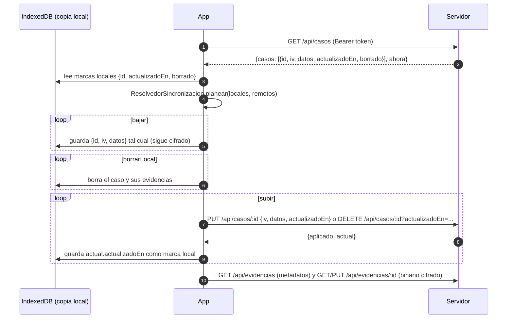

# Base de datos y sincronización cifrada

VozVial guarda una copia de la cuenta, los casos y las evidencias en un servidor para poder usar la app en otro
celular. La regla es la misma que en el dispositivo: **el servidor solo guarda datos cifrados y no puede leer
casos, evidencias ni el nombre**. El cifrado es de extremo a extremo: se cifra en el celular con una clave que
nunca sale de él.

## Qué se guarda y dónde

| Dónde | Motor | Cuándo |
|---|---|---|
| Railway | Postgres (servicio "Postgres", variable `DATABASE_URL` por red interna) | Producción |
| Local y pruebas | PGlite (`@electric-sql/pglite`): Postgres compilado a WASM dentro del mismo proceso de Node | Cuando no hay `DATABASE_URL` |

El código es el mismo para los dos (`src/servidor/bd/conexion.ts` elige `pg` o PGlite). Las migraciones están en
`src/servidor/bd/migraciones.ts`, son versionadas e idempotentes y corren al arrancar el servidor.

### Esquema

| Tabla | Columnas | Qué es en claro |
|---|---|---|
| `cuentas` | `id` (uuid), `celular` (único), `sal_auth`, `iteraciones_auth`, `verificador_pin`, `verificador_codigo`, `clave_envuelta_pin`, `clave_envuelta_codigo`, `perfil_cifrado`, `creada_en`, `intentos_fallidos`, `bloqueada_hasta` | Solo el celular (para entrar), sales, iteraciones, contadores y fechas. Los verificadores están protegidos con scrypt; las claves y el perfil (nombre) van cifrados con AES-GCM. |
| `sesiones` | `token_hash`, `cuenta_id`, `creada_en`, `expira_en` | El SHA-256 del token, nunca el token. |
| `casos` | `cuenta_id`, `id`, `iv`, `datos`, `actualizado_en`, `borrado` | Nada del caso: `datos` es el JSON del `Caso` cifrado con AES-GCM (el mismo formato que IndexedDB). |
| `evidencias` | `cuenta_id`, `id`, `caso_id`, `iv`, `datos` (bytea), `mime`, `tamano`, `actualizado_en` | El tipo de archivo (`audio/…` o `image/…`) y su tamaño; el contenido va cifrado. |

Todas las consultas de casos y evidencias filtran por `cuenta_id` (es parte de la llave primaria), así que una
cuenta no puede leer ni pisar datos de otra aunque conozca un id.

Límites: 8 MB por evidencia (`MAX_BYTES_EVIDENCIA`), 1 MB por petición JSON, 100 MB por cuenta
(`CUOTA_CUENTA_BYTES`) y 30 peticiones por minuto por IP en registro, sesión, recuperación y parámetros
(`LIMITE_PETICIONES_MINUTO`).

## Dos secretos distintos salen del PIN

El celular deriva del PIN dos cosas que no se pueden calcular una desde la otra:

1. **Clave de envoltura** (ya existía, `GestorClaves`): `PBKDF2(PIN, sal_envoltura)` abre la clave de datos
   AES-256 que cifra casos y evidencias. **Nunca sale del celular.**
2. **Verificador de autenticación** (nuevo, `DerivadorVerificador`):
   `PBKDF2("vozvial/autenticacion/pin/v1|" + PIN, sal_auth)`. Es lo único que viaja al servidor. El prefijo
   separa los dominios: aunque las sales coincidieran, el verificador no abre la clave de datos (hay una prueba
   unitaria que lo comprueba).

Con el código de recuperación pasa lo mismo, con el prefijo `vozvial/autenticacion/codigo/v1|`.

El servidor no guarda el verificador tal cual: le aplica **scrypt** con una sal propia (N = 2^15, r = 8, p = 1).
Así, quien copie la tabla no puede entrar mandando el valor guardado, y para probar PIN tendría que hacer
PBKDF2 + scrypt por cada intento.

## Protocolo

### Registro

```mermaid
sequenceDiagram
    autonumber
    participant C as Celular (app)
    participant S as Servidor
    participant B as Postgres
    Note over C: Crea la cuenta local (ServicioCuenta):<br/>clave de datos aleatoria, envueltas con PIN y con código,<br/>perfil {nombre, celular} cifrado
    C->>C: sal_auth aleatoria; verificador_pin y verificador_codigo (PBKDF2 con prefijo)
    C->>S: POST /api/cuentas {celular, salAuth, iteraciones, verificadorPin, verificadorCodigo,<br/>claveEnvueltaPin, claveEnvueltaCodigo, perfilCifrado}
    S->>S: scrypt(verificador, sal del servidor)
    S->>B: INSERT cuentas (si el celular ya existe: 409 ya_existe)
    S->>B: INSERT sesiones (SHA-256 del token)
    S-->>C: 201 {token, expiraEn}
```

### Entrar en otro celular

```mermaid
sequenceDiagram
    autonumber
    participant C as Celular nuevo
    participant S as Servidor
    participant B as Postgres
    C->>S: GET /api/cuentas/parametros?celular=3001112233
    alt el celular tiene cuenta
        S-->>C: {salAuth real, iteraciones}
    else no tiene cuenta
        S-->>C: {salAuth = HMAC(SECRETO_SERVIDOR, celular), iteraciones por defecto}
    end
    C->>C: verificador = PBKDF2(prefijo + PIN, salAuth)
    C->>S: POST /api/sesiones {celular, verificador}
    S->>B: lee la cuenta y el contador de intentos
    alt bloqueada (5 fallos seguidos)
        S-->>C: 423 {error: bloqueada, msRestantes}
    else verificador incorrecto o celular inexistente
        S->>B: suma un fallo (en memoria si el celular no existe)
        S-->>C: 401 {error: credenciales_invalidas, intentosRestantes}
    else correcto
        S->>B: reinicia intentos; crea sesión
        S-->>C: 200 {token, expiraEn, claveEnvueltaPin, claveEnvueltaCodigo, perfilCifrado}
        C->>C: abre la clave de datos con el PIN y descifra el perfil
    end
```

### Recuperar con el código (dos pasos)

El cliente necesita la clave envuelta con el código para abrir la clave de datos y envolverla con el PIN nuevo.
Por eso la recuperación tiene un paso previo (`/api/recuperacion/clave`) que no estaba en el plan inicial.

```mermaid
sequenceDiagram
    autonumber
    participant C as Celular
    participant S as Servidor
    C->>S: GET /api/cuentas/parametros?celular=...
    S-->>C: {salAuth, iteraciones}
    C->>S: POST /api/recuperacion/clave {celular, verificadorCodigo}
    S-->>C: 200 {claveEnvueltaCodigo, perfilCifrado} o 401 codigo_invalido
    C->>C: abre la clave de datos con el código; la envuelve con el PIN nuevo; deriva el verificador nuevo
    C->>S: POST /api/recuperacion {celular, verificadorCodigo, verificadorPin, claveEnvueltaPin}
    S->>S: guarda el verificador nuevo, reinicia el bloqueo y cierra todas las sesiones
    S-->>C: 200 {token, expiraEn, claveEnvueltaPin, claveEnvueltaCodigo, perfilCifrado}
```

La clave de datos no cambia, así que los casos que ya estaban en el servidor se siguen abriendo.

### Sincronizar casos y evidencias



## Rutas

Todas responden JSON con `Cache-Control: no-store`. Los errores son `{error, mensaje}` con un mensaje sencillo
en español. Las rutas con [sesión] llevan `Authorization: Bearer <token>`.

| Método y ruta | Cuerpo | Respuesta |
|---|---|---|
| `GET /api/cuentas/parametros?celular=` | — | `{salAuth, iteraciones}` (sal falsa estable si no hay cuenta) |
| `POST /api/cuentas` | `{celular, salAuth, iteraciones, verificadorPin, verificadorCodigo, claveEnvueltaPin, claveEnvueltaCodigo, perfilCifrado}` | `201 {token, expiraEn}` · `409 ya_existe` |
| `POST /api/sesiones` | `{celular, verificador}` | `200 {token, expiraEn, claveEnvueltaPin, claveEnvueltaCodigo, perfilCifrado}` · `401 credenciales_invalidas {intentosRestantes}` · `423 bloqueada {msRestantes}` |
| `DELETE /api/sesiones` [sesión] | — | `204` |
| `POST /api/recuperacion/clave` | `{celular, verificadorCodigo}` | `200 {claveEnvueltaCodigo, perfilCifrado}` · `401 codigo_invalido` |
| `POST /api/recuperacion` | `{celular, verificadorCodigo, verificadorPin, claveEnvueltaPin}` | igual que `POST /api/sesiones` |
| `DELETE /api/cuenta` [sesión] | `{verificadorPin}` | `204` (borra cuenta, sesiones, casos y evidencias) · `401` |
| `GET /api/casos[?desde=ISO]` [sesión] | — | `{casos: [...], ahora}` (incluye marcas de borrado) |
| `DELETE /api/casos` [sesión] | — | `{borrados}` |
| `GET /api/casos/:id` [sesión] | — | `{id, iv, datos, actualizadoEn, borrado}` · `404` |
| `PUT /api/casos/:id` [sesión] | `{iv, datos, actualizadoEn}` | `{aplicado, actual}` |
| `DELETE /api/casos/:id[?actualizadoEn=]` [sesión] | — | `{aplicado, actual}` (marca de borrado; borra sus evidencias) |
| `GET /api/evidencias` [sesión] | — | `{evidencias: [{id, casoId, iv, mime, tamano, actualizadoEn}]}` |
| `GET /api/evidencias/:id` [sesión] | — | binario cifrado con cabeceras `X-VozVial-Caso`, `X-VozVial-IV`, `X-VozVial-Mime`, `X-VozVial-Actualizado` |
| `PUT /api/evidencias/:id` [sesión] | binario cifrado + las mismas cabeceras | `{aplicado, actual}` · `404 caso_no_encontrado` · `413 muy_grande` / `cuota_excedida` |
| `DELETE /api/evidencias/:id` [sesión] | — | `{borrada}` |

Otros códigos: `400 datos_invalidos {campo}`, `401 no_autorizado`, `429 limite_peticiones` (con `Retry-After`),
`503 bd_no_disponible` (la base no arrancó; el resto de la app sigue funcionando).

## Gana el más reciente

- Cada caso lleva `actualizadoEn`. El servidor solo reemplaza si la versión que llega es **más reciente**; si no,
  responde `aplicado: false` con la versión que tenía.
- Una marca de tiempo del futuro (reloj del celular adelantado) se recorta a la hora del servidor. Por eso el
  cliente debe guardar `actual.actualizadoEn` después de subir.
- Los borrados son **marcas**: el caso queda con `borrado: true` y sin datos, y sus evidencias se eliminan. Así el
  otro celular sabe que debe borrarlo.
- La lógica de comparación vive en `src/core/ResolvedorSincronizacion.ts` (sin dependencias de React ni de red).

## Qué no revela el servidor

- `GET /api/cuentas/parametros` devuelve una sal falsa estable (HMAC con `SECRETO_SERVIDOR`) para celulares no
  registrados, con la misma forma que la real.
- `POST /api/sesiones` responde igual para un celular inexistente que para un PIN incorrecto, cuenta los intentos
  y bloquea igual (los inexistentes se cuentan en memoria) y hace un scrypt de relleno para tardar parecido.
- **Límite honesto:** el registro sí dice `409 ya_existe` cuando el celular ya tiene cuenta (no hay otra forma de
  evitar dos cuentas con el mismo número sin verificación por SMS). Lo frena el límite de peticiones por IP.
- Las iteraciones que se anuncian a un celular sin cuenta son las de producción (600 000). Si una cuenta se
  registró con otras (por ejemplo, el build de e2e usa 1000), esa diferencia la delata. En producción coinciden.

## Logs

El servidor no escribe cuerpos de peticiones, tokens, celulares ni la URL de la base. Al arrancar solo dice qué
motor usa y de dónde salió el secreto (por ejemplo, `API de datos lista (Postgres; secreto definido)`).

## Variables de entorno del servidor

| Variable | Por defecto | Uso |
|---|---|---|
| `DATABASE_URL` | — | Postgres. Sin ella, PGlite. |
| `PGLITE_DIR` | — | Carpeta para que PGlite guarde en disco (si no, vive en memoria). |
| `SECRETO_SERVIDOR` | Derivado de `DATABASE_URL`, o uno de desarrollo si no hay base | HMAC de las sales falsas. **Definirlo en Railway.** |
| `BLOQUEO_CUENTA_MS` | 300000 (5 min, CA-02.3) | Duración del bloqueo. El e2e usa 3000. |
| `ITERACIONES_AUTENTICACION` | 600000 | Iteraciones que se anuncian a celulares sin cuenta. |
| `ITERACIONES_MINIMAS` | 1000 | Mínimo aceptado al registrar. |
| `SESION_HORAS` | 168 | Duración de la sesión. |
| `LIMITE_PETICIONES_MINUTO` | 30 | Por IP y por tipo de ruta de cuenta. |
| `MAX_BYTES_EVIDENCIA` / `CUOTA_CUENTA_BYTES` | 8 MB / 100 MB | Límites de tamaño. |
| `SCRYPT_N` | 32768 | Costo de scrypt (potencia de 2; las pruebas usan 1024). |
| `CONFIAR_PROXY` | `1` si existe `RAILWAY_ENVIRONMENT` | Tomar la IP de `X-Forwarded-For`. |

## Qué es simulado o limitado

- El límite de peticiones y el conteo de intentos de celulares inexistentes viven **en memoria**: sirven para una
  sola instancia (la de Railway) y se reinician al reiniciar el servidor.
- No hay verificación del celular por SMS: cualquiera puede registrar un número que no es suyo. Para el prototipo
  se acepta y se declara.
- Las cuentas de demostración (`docs/usuarios-demo.md`) son ficticias y públicas.

## Pruebas

`tests/unit/servidor/bd/` corre la API real sobre PGlite en memoria y un servidor HTTP local: registro, sesión
correcta e incorrecta, bloqueo, que no revela si un celular existe, recuperación, CRUD de casos con aislamiento
entre cuentas, evidencias, límites de tamaño, borrar cuenta, límite de peticiones, 503 sin base y la semilla.
